# Data flow

Where a client's data goes when the deck runs in the client's cloud. Everything below is what the
code does today; the pieces marked *planned* are named as such.

```mermaid
flowchart LR
  subgraph browser["Person's browser (inside the client's network)"]
    deck["Subsurface deck<br/>static bundle, CSP"]
    mem["Tokens: memory only"]
    store["localStorage / IndexedDB<br/>user-authored wells, designs, analyses"]
  end
  subgraph cloud["Client's cloud"]
    host["Deck host<br/>static files + config.json<br/>/version.json /healthz"]
    idp["Client's identity provider<br/>OIDC, PKCE, public client"]
    osdu["Client's data platform<br/>OSDU Search, Storage, Wellbore DDMS<br/>(or contract-json files)"]
  end
  subgraph us["Vendor (outside)"]
    reg["Release registry<br/>signed image, bundle, SBOMs"]
  end
  host -- "HTML, JS, CSS, samples (optional)" --> deck
  deck -- "authorization code + PKCE" --> idp
  idp -- "id token, access token, refresh token" --> mem
  deck -- "GET/POST with the user's bearer token<br/>and data-partition-id" --> osdu
  osdu -- "wells, wellbores, trajectories, markers<br/>(headers first, detail per field)" --> deck
  deck <-- "the person's own entries" --> store
  reg -. "pulled by the client's operator, verified,<br/>mirrored, deployed by digest" .-> host
  deck x--x us
```

## What crosses which boundary

| Flow | What | Protection |
|---|---|---|
| Host → browser | the deck's files, `config.json` (public values only), sample data if the deployment lists `samples` | TLS; CSP with script hashes; `config.json` refused if it holds a credential |
| Browser ↔ identity provider | authorization request, code exchange with PKCE, refresh, RP-initiated logout | the deck is a public client with no secret; `state` and `nonce` checked; tokens kept in memory; `prompt=none` renewal capped at two per five minutes |
| Browser ↔ data platform | every request with the user's own bearer token; reads only | `fetchGuarded`: time limit, retries with `Retry-After`, 64 MB byte cap, one refresh on 401, no token in any error message; CSP `connect-src` lists only this origin and the provider's |
| Browser ↔ its own storage | wells, designs and analyses the person typed; nothing read from the platform is stored | per-origin; export is the person's own copy; per-user namespacing *planned* (P6) |
| Browser → another person | a share link: ids and view state (`share.mode: "reference"`, the client default) | a client well's data never travels in a link; the public demo's `carry` mode carries only the sender's own entries |
| Browser → support | the diagnostics bundle a person copies from Data sources | counts, statuses and origins only: no well, no token, no person, no URL path |
| Vendor → client | releases | cosign signatures, CycloneDX SBOMs, a signed manifest; the client verifies and mirrors |
| Browser or host → vendor | **nothing** | no telemetry, no update check beyond the deck's own origin, no licence call |

## What the deck never does

- It never writes to the client's platform (read-only; write-back is a later, separate decision).
- It never stores a token (storage, cookies, URL or history).
- It never places a well at a guessed location: a record without one is listed, not drawn.
- It never sends a client's data anywhere but the screen and the person's own browser storage.

## Logs

The deck host (the server in `tools/serve.mjs`, and the container that *P1* adds) logs requests
as JSON: method, path, status, bytes and timing. Paths never carry data or tokens: the deck puts
nothing personal in a URL, and share links ride in the fragment, which a browser never sends.
